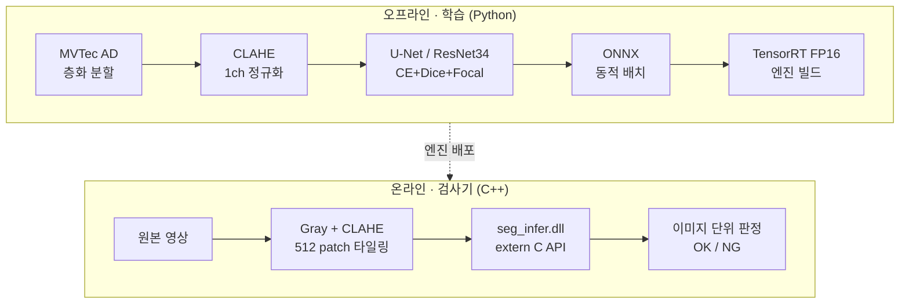

# defect-seg-trt

**산업용 결함 Segmentation 모델을 비전 검사기에 붙이는 전 과정 재현**

PyTorch 학습 → ONNX 변환 → TensorRT FP16 엔진 → C++ 추론 DLL(`extern "C"`) → 검사기 호출 벤치마크

실무에서 개발한 딥러닝 이물 판정 시스템의 구조를, 회사 데이터와 코드 없이 공개 데이터셋(MVTec AD)으로 처음부터 다시 구현한 저장소입니다.
모델 정확도뿐 아니라 **설비 PC에서 사이클 타임 안에 멈추지 않고 동작하는 것**을 목표로 합니다.

---

## 문제 정의

실무 문제는 *같은 '이물'이라도 위치에 따라 판정이 달라지는* 분류였습니다 (내부 이물 = 불량, 외부 이물 = 양품).
이를 MVTec AD `carpet` 카테고리로 다음과 같이 옮겼습니다.

| 클래스 | MVTec AD 폴더 | 판정 | 실무 대응 |
|---|---|---|---|
| 0 background | `good` + 결함 이미지의 정상 영역 | OK | 정상 |
| 1 metal_contamination | `test/metal_contamination` | **NG** | 내부 이물 |
| 2 thread | `test/thread` | OK | 외부 이물 |

- 결함 이미지는 유형별 십수 장 수준 → 실무와 같은 **소량 데이터** 조건
- 두 클래스 모두 표면 위 이물이라 밝기 기반 룰로는 구분이 어렵고, 형상·질감으로 구분해야 함
- 판정 규칙: NG 클래스 면적 ≥ `min_area` 이면 NG, 아니면 나머지 결함 중 최대 면적 클래스, 모두 미만이면 정상

## 시스템 구성



DLL 내부 처리 (한 번의 `seg_infer` 호출 = 이미지 1장의 patch 묶음 1 chunk):

```
pinned 버퍼 복사 → H2D(uint8) → [CUDA] 정규화 → [TensorRT] enqueueV3
→ [CUDA] argmax + 클래스 면적 집계 → D2H(마스크 uint8, 면적) → 판정
```

## 설계 결정

| 조건 | 결정 | 이유 |
|---|---|---|
| 결함 위치·형상 보존 필요 | U-Net Segmentation | 이미지 분류보다 판정 근거(위치, 면적)를 남길 수 있음 |
| 결함 이미지 소량 | ImageNet 사전학습 ResNet34 encoder, 1ch 입력 | 1ch 변환 시 첫 conv 가중치를 채널 합산해 사전학습 효과 유지 |
| 배경 대비 결함 픽셀 극소 | CE(클래스 가중치) + Dice + Focal | 역빈도 제곱근 가중치(배경 1, 상한 10)로 희소 클래스 보정, Dice로 작은 영역 겹침 직접 최적화 |
| GPU 메모리 4GB (배치 2) | 인코더 BN 고정, 디코더 정규화 제거, gradient accumulation | 작은 배치에서 BatchNorm 통계가 흔들리는 문제 방지, 유효 배치 8 유지 (아래 '트러블슈팅') |
| 미세 결함 국소 대비 부족 | CLAHE 전처리 | 조명 편차에 강하고 DLL 호출 측에서도 동일하게 재현 가능 |
| 결함이 이미지 일부에만 존재 | 결함 위치 편향 crop (확률 0.8) | 학습 patch 대부분이 배경만 되는 문제 방지 |
| 설비 PC 실시간 처리 | TensorRT FP16, 동적 배치 프로파일 | 1024² 이미지 = 512² patch 4장을 1 chunk로 한 번에 추론 |
| 반복 호출 오버헤드 | GPU·pinned 버퍼를 `seg_create`에서 1회 사전 할당 | 호출마다 `cudaMalloc` 하지 않음, 텐서 주소도 생성 시 1회 바인딩 |
| D2H 전송량 | argmax·면적 집계를 GPU 커널에서 수행 | logit(float × C) 대신 uint8 마스크와 면적만 복사 |
| 다중 스레드 호출 | 핸들별 mutex로 호출 직렬화 | 같은 execution context의 동시 enqueue 방지 |
| DLL 경계 안정성 | C ABI + 상태 코드, 예외는 경계 안에서 처리 | 예외가 검사기 프로그램으로 전파되어 프로세스가 종료되는 것을 방지 |
| 전처리 일관성 | 정규화 식·판정 규칙을 Python/C++ 양쪽에 동일 구현 | `tests/test_dll.py`로 ONNX Runtime 결과와 픽셀 단위 비교 |

## 폴더 구조

```
configs/carpet.yaml        데이터·전처리·모델·학습·판정 설정 (한 곳에서 관리)
src/
  common.py                전처리, 판정 규칙, 모델 생성 (C++와 공유하는 규칙)
  dataset.py               MVTec AD 스캔, 층화 분할(split.json 고정), 학습/평가 Dataset
  losses.py                CE + Dice + Focal, 역빈도 제곱근 클래스 가중치
  train.py                 학습 (AMP, OneCycleLR, best 체크포인트)
  evaluate.py              픽셀 IoU/Dice, 이미지 단위 혼동행렬·Precision/Recall
  export_onnx.py           ONNX 변환 (동적 배치)
  verify_onnx.py           PyTorch vs ONNX Runtime 정합성 + 속도
scripts/build_engine.ps1   trtexec로 TensorRT FP16 엔진 빌드
cpp/
  include/seg_infer.h      DLL 공개 API (C ABI)
  src/seg_infer.cpp        엔진 로드, 버퍼 사전 할당, 직렬화, 예외 경계
  src/kernels.cu           정규화 / argmax + 면적 집계 CUDA 커널
  bench/bench.cpp          검사기 역할 예제: CLAHE·타일링 → DLL 호출 → 판정 → 지연시간 통계
tests/
  test_dll.py              ctypes로 DLL 호출, ONNX Runtime과 결과 비교
  make_synthetic_mvtec.py  실제 데이터 없이 파이프라인 동작 확인용 합성 데이터
```

## 실행 방법 (Windows)

### 0. 준비물

| 항목 | 버전 |
|---|---|
| NVIDIA 드라이버 / GPU | RTX 30 이상 (RTX 50 시리즈는 CUDA 12.8+, TensorRT 10.8+ 필요) |
| CUDA Toolkit | 12.x |
| TensorRT | 10.x (zip 패키지 압축 해제 후 `bin`을 PATH에 추가) |
| Visual Studio 2022 | "C++를 사용한 데스크톱 개발" 워크로드 |
| CMake | 3.20 이상 |
| OpenCV (벤치마크용) | 4.x Windows 빌드, `OpenCV_DIR`에 `build` 폴더 지정 |
| Python | 3.10 ~ 3.12 |

설치 후 `.\scripts\check_env.ps1`로 모든 항목이 `[OK]`인지 먼저 확인합니다.

```powershell
python -m venv .venv
.venv\Scripts\activate
pip install torch torchvision --index-url https://download.pytorch.org/whl/cu128
pip install -r requirements.txt
```

### 1. 데이터 준비

[MVTec AD](https://www.mvtec.com/company/research/datasets/mvtec-ad) 공식 페이지에서 `carpet` 카테고리를 내려받아 아래 구조로 둡니다. (데이터셋은 CC BY-NC-SA 4.0 라이선스로, 이 저장소에는 포함하지 않습니다.)

```
data/mvtec_ad/carpet/{train,test,ground_truth}/...
```

> 데이터 없이 파이프라인만 확인하려면 `python tests/make_synthetic_mvtec.py --root data/synthetic` 후 설정의 `data.root`를 바꿔 실행합니다.

### 2. 학습 · 평가

```powershell
python src/train.py --config configs/carpet.yaml --batch-size 2 --accum 4   # GPU 4GB 기준 (유효 배치 8)
python src/evaluate.py --config configs/carpet.yaml --ckpt runs/carpet/best.pth --split test
```

- 분할은 처음 실행 시 `runs/carpet/split.json`에 고정되어, 이후 평가·변환·DLL 검증이 같은 test셋을 사용합니다.
- 결과: `runs/carpet/eval_test.json`

### 3. ONNX 변환 · 정합성 검증

```powershell
python src/export_onnx.py --ckpt runs/carpet/best.pth --out runs/carpet/model.onnx
python src/verify_onnx.py --ckpt runs/carpet/best.pth --onnx runs/carpet/model.onnx
```

결과: `runs/carpet/verify_onnx.json` (logit 최대 오차, argmax 일치율, 판정 일치 수)

### 4. TensorRT FP16 엔진 빌드

```powershell
.\scripts\build_engine.ps1 -Onnx runs\carpet\model.onnx -Engine runs\carpet\model_fp16.engine
```

엔진은 빌드한 GPU·TensorRT 버전에서만 동작하므로 PC가 바뀌면 다시 빌드합니다.

### 5. DLL · 벤치마크 빌드

```powershell
cmake -S cpp -B cpp/build -G "Visual Studio 17 2022" -A x64 `
      -DTENSORRT_ROOT="C:/TensorRT-10.x.x.x" -DOpenCV_DIR="C:/opencv/build"
cmake --build cpp/build --config Release
```

산출물: `cpp/build/Release/seg_infer.dll`, `seg_bench.exe`
(실행 시 TensorRT `bin`, CUDA `bin`, OpenCV `bin`이 PATH에 있어야 합니다. 링크 시 `LNK4098 LIBCMT` 경고는 정적 CUDA 런타임 때문에 나며 동작에는 영향이 없습니다.)

### 6. DLL 정합성 검증 (ctypes)

```powershell
python tests/test_dll.py --ckpt runs/carpet/best.pth --onnx runs/carpet/model.onnx `
       --engine runs/carpet/model_fp16.engine --dll cpp/build/Release/seg_infer.dll
```

결과: `runs/carpet/test_dll.json` (FP16 DLL vs FP32 ONNX 픽셀 일치율, 정답 대비 정확도, NG 미검출 수)

### 7. 지연시간 벤치마크

```powershell
cpp\build\Release\seg_bench.exe --engine runs\carpet\model_fp16.engine `
    --list runs\carpet\test_images.txt --out runs\carpet\bench --iters 500
```

결과: `runs/carpet/bench/latency.json`, `predictions.csv`

## 결과

모든 값은 test셋(학습·검증에 쓰지 않은 16장: 정상 8, metal 4, thread 4) 기준입니다.

**환경**: RTX 3050 4GB Laptop GPU (sm_86) / CUDA 12.8 / TensorRT 10.16.1 / Driver 617.42 / Windows, VS 2022

| 구분 | 지표 | 값 | 출처 |
|---|---|---|---|
| 픽셀 | IoU (metal_contamination / thread) | 0.735 / 0.588 | `eval_test.json` |
| 픽셀 | mIoU (결함 클래스 평균) | 0.662 | `eval_test.json` |
| 이미지 | 판정 정확도, Macro F1 | 0.938 (15/16), 0.941 | `eval_test.json` |
| 이미지 | NG Recall (미검출 수) | 1.0 (0) | `eval_test.json` |
| 변환 | ONNX vs PyTorch argmax 일치율 / 판정 일치 | 1.0 / 16/16 (logit 최대 차이 7.6e-5) | `verify_onnx.json` |
| 변환 | FP16 DLL vs FP32 ONNX 픽셀 일치율 / 판정 일치 | 0.999995 / 16/16 | `test_dll.json` |
| 속도 | TensorRT 순수 GPU 계산 (trtexec) ms / chunk | 24.3 | `model_fp16.build.log` |
| 속도 | DLL ms / chunk (mean / p99, 500회) | 22.0 / 22.4 | `bench/latency.json` |
| 안정성 | 벤치마크 500회 반복 중 오류 | 0 | `seg_bench` 출력 |

- 1 chunk = 1024×1024 이미지의 512×512 patch 4장. DLL 시간은 H2D·정규화·추론·argmax·D2H를 모두 포함 (이미지 읽기·CLAHE 제외)
- 유일한 오판 1건은 정상 이미지를 thread(OK 결함)로 판정한 경우로, NG 방향의 미검출은 없음
- PyTorch → ONNX → TensorRT FP16 → C++ DLL 전 구간에서 이미지 판정이 한 번도 바뀌지 않음

## 트러블슈팅: 작은 배치에서 학습이 무너진 문제

| | 1차 학습 | 수정 후 |
|---|---|---|
| 설정 | 배치 2, 디코더 BN, 배경 가중치 0.02 | 배치 2 × 누적 4, 인코더 BN 고정, 디코더 정규화 없음, 배경 가중치 1 |
| best val mIoU(결함) | 0.12 | 0.61 |
| 마지막 에폭 val NG Recall | 0.0 | 0.67 (val NG 3장 중 2장) |

- **증상**: 학습 loss는 내려가는데 검증 지표가 0 근처에서 흔들리고, 마지막에는 NG를 하나도 못 잡음
- **원인 1**: GPU 메모리 4GB 때문에 배치 2로 학습 → BatchNorm이 2장짜리 통계로 정규화하다 보니 학습(train 모드)과 추론(eval 모드)의 출력이 크게 어긋남
- **원인 2**: 픽셀 빈도 기반 가중치가 배경을 0.02까지 낮춤 → 결함 과다 예측과 불안정한 그래디언트
- **조치**: 사전학습 인코더의 BN을 ImageNet 통계로 고정(`freeze_encoder_bn`), 디코더는 정규화 없이 구성, gradient accumulation으로 유효 배치 8 유지, 가중치는 배경 1 기준 역빈도 제곱근(상한 10)으로 완화
- 설비 PC처럼 GPU 자원이 제한된 환경에서 재학습해야 할 때 그대로 적용할 수 있는 설정

## DLL API

```c
SegConfig cfg;  seg_default_config(&cfg);          // patch 512, max_batch 4, 3 classes ...
SegHandle h;    seg_create("model_fp16.engine", &cfg, &h);

SegResult res[4];  float ms;
int rc = seg_infer(h, patches_u8, 4, masks_u8 /*NULL 가능*/, res, &ms);
if (rc != SEG_OK) printf("%s\n", seg_last_error(h));

int area[3] = { /* patch별 res[i].area 합 */ };
int cls = seg_decide(area, 3, cfg.ng_class, cfg.min_area);   // 0=OK, 1=NG(metal), 2=thread
seg_destroy(h);
```

전체 명세는 [`cpp/include/seg_infer.h`](cpp/include/seg_infer.h) 참고.

## 한계와 다음 단계

- MVTec AD 결함 이미지는 유형별 수가 적어 test셋이 작습니다. 지표는 분할 seed에 따라 변동이 있을 수 있습니다.
- 겹치는 타일이 생기는 이미지 크기에서는 Python 평가(겹침 logit 평균)와 DLL(patch별 면적 합) 결과가 경계에서 조금 다를 수 있습니다. 1024×1024 + 512 patch 조합은 겹침이 없습니다.
- 다음 단계: CUDA Graph 캡처로 호출 오버헤드 축소, INT8 캘리브레이션, 호기별 데이터 드리프트 감지와 재학습 파이프라인

## License

Code: MIT. Dataset: MVTec AD (CC BY-NC-SA 4.0), 이 저장소에 포함하지 않음.
